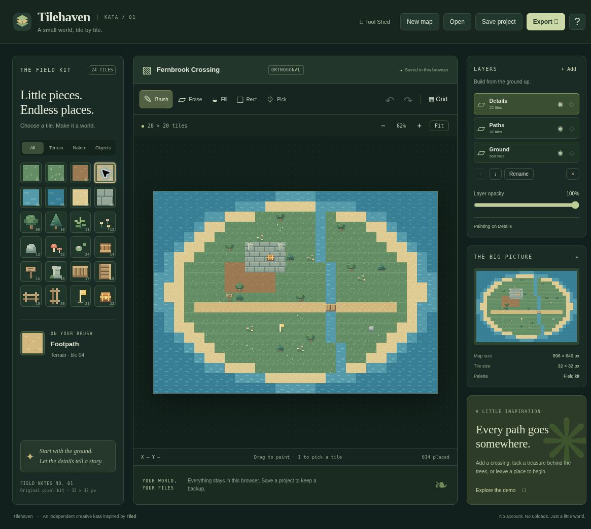

# Tilehaven

**A small world, tile by tile.**

Tilehaven is an original, local-first tile-map editor for the [Kata Tool Shed](https://intrepion.github.io/tools/). It takes inspiration from [Tiled](https://www.mapeditor.org/), with its own interface, artwork, and deliberately smaller scope. It is not an official Tiled product or a feature-for-feature replacement.



## Make a little world

- Paint with 24 original 32×32 pixel tiles: terrain, trees, flowers, ruins, bridges, treasure, and a start marker.
- Brush, eraser, contiguous flood fill, filled rectangle, and active-layer tile picker.
- Maps from 4×4 to 64×64 tiles and up to eight named layers, ordered bottom to top.
- Layer visibility, painting locks, opacity, reorder, rename, add, and recoverable deletion.
- Stroke-level undo/redo with 80 history steps.
- Grid, fit-to-view, zoom, scrollable canvas, coordinates, and whole-map preview.
- Blank canvas, Fernbrook Crossing, and Forgotten Courtyard starters.
- Keyboard painting and responsive narrow layouts.
- Versioned editable JSON backups, validated project opening, and best-effort browser autosave.
- PNG of visible layers with transparent empty cells.
- A ZIP containing a finite orthogonal Tiled `.tmj` map and its matching PNG tile atlas.

## Run locally

Requires Node.js 22 or newer. There are no runtime or development dependencies to install.

```sh
npm run dev
```

Then open **http://127.0.0.1:4173/** in a browser. Always run a server and use localhost for testing. Do not open HTML files directly through `file://`.

Alternative port:

```sh
npm run dev -- --host 127.0.0.1 --port 4190
```

Production static output:

```sh
npm run check
npm test
npm run build
```

The generated `dist/` is a self-contained static app. No build tools, fonts, images, or application code are fetched from a CDN. The original pixel atlas is drawn locally from `src/tiles.js`. GitHub Actions checks and builds every change. The Pages workflow deploys `main` to [the public Tilehaven app](https://intrepion.github.io/kata-app-inspired-by-tiled-codex-dot/).

## Editing

Choose a tile and layer, then click or drag on the map. Upper layers cover lower layers. The picker reads the **active layer**, not the topmost visible composite. Hidden and locked layers cannot be painted. Opacity does not prevent editing. A lock is a painting guard; the layer can still be renamed, reordered, or explicitly removed.

- **B** brush, **E** erase, **F** fill, **R** rectangle, **I** picker, **G** grid.
- **Ctrl/⌘ Z** undo, **Ctrl/⌘ Shift Z** or **Ctrl/⌘ Y** redo.
- **Ctrl/⌘ S** downloads an editable project backup.
- **Esc** cancels an in-progress stroke or keyboard rectangle; leaving the window also cancels a pointer stroke.
- Focus the canvas, use arrows to move, and **Space** or **Enter** to apply. For a keyboard rectangle, apply at each corner.
- **Alt-click** picks a tile. Use Fit, the zoom buttons, and canvas scrollbars to navigate. On narrow screens, scroll outside the canvas to move the page.

The start flag, chest, sign and other props are visual tiles only. They do not create gameplay logic, collision, or object metadata.

## Files and privacy

Everything stays in the browser. No accounts, analytics, uploads, or server-side storage are used. Only the links to the Tool Shed and Tiled leave the app.

**Save project** downloads `.tilehaven.json`, containing dimensions, all layers, tile IDs, visibility, opacity, painting locks, and the active layer. It does not include undo history, zoom, grid, selected tool, or brush selection. **Open** accepts only Tilehaven version-1 JSON, with an upper size limit of 2 MB. Invalid files are rejected without changing the current map. Opening or creating a project asks before replacing the map and resets undo history.

Autosave uses localStorage after edits. Browser storage can be unavailable or cleared and is **not a backup**. The app warns when storage cannot be written. If an autosaved project cannot be read, its original payload is preserved, autosave pauses, and the recovery dialog lets you download the raw data before explicitly replacing it. Save project files for important work. Avoid editing the same project in several tabs: there is no cross-tab merge, and the most recent write wins.

### Tiled export, honestly scoped

The ZIP contains:

1. `<map-name>.tmj`: finite, orthogonal tile layers in Tiled's JSON map structure.
2. `tilehaven-atlas.png`: the original 256×96 image, with 8 columns × 3 rows of 32px tiles.
3. `README.txt`: instructions and limits.

Unzip the files together, then open the `.tmj` file in Tiled. The embedded tileset points to the relative PNG path. Empty cells use GID 0 and the tileset starts at `firstgid: 1`. Names, tile order, visibility, and opacity are preserved. Painting locks are included as the custom boolean layer property `tilehaven_locked`, not as native Tiled locks.

The export was structurally checked against official documentation and the downloaded ZIP/PNG was decoded and compared to the project. It has **not been opened in the native Tiled desktop application** in this environment. Do not interpret the export as full Tiled interchange support.

Tilehaven does **not** import Tiled JSON, TMX, TSX, external or custom tilesets, image/object/group layers, infinite chunks, flipped/rotated tiles, terrain/Wang rules, tile animations, collision, or game-engine scripts. Keep your Tilehaven JSON to continue editing here.

## Browser regression harness

With the server running, open http://127.0.0.1:4173/tests/browser.html and click **Run tests**. The opt-in suite loads the real app in an iframe and temporarily replaces its autosave key, restoring the original in `finally`. Use a disposable browser profile and save important work before testing. Its pointer events use a clearly labeled synthetic capture bookkeeping double; this is not a physical multitouch test.

## Implementation

- `src/model.js`: strict versioned project validation, drawing algorithms, templates, history, and Tiled JSON conversion.
- `src/tiles.js`: original procedural pixel art and cached atlas.
- `src/app.js`: DOM editor, canvas rendering, keyboard/pointer editing, storage and downloads.
- `src/archive.js`: small dependency-free ZIP/CRC32 writer.
- `tests/`: pure model and archive tests.
- `docs/QA.md`: actual verification coverage and remaining limits.
- `app.json` and `docs/tool-shed-entry.json`: app metadata and the Tool Shed listing record.

## Inspiration and license

The original Tiled documentation informed the workflow and export structure:

- [Editing tile layers](https://doc.mapeditor.org/en/stable/manual/editing-tile-layers/)
- [JSON map format](https://doc.mapeditor.org/en/stable/reference/json-map-format/)
- [Global tile IDs](https://doc.mapeditor.org/en/stable/reference/global-tile-ids/)

All code, procedural pixel graphics, demo arrangements, and the Tilehaven logo in this repository are original and released under the [MIT License](LICENSE). No Tiled code, assets, logos, or documentation text was copied. The combined `.gitignore` covers macOS, Windows, Linux, common editors, generated output, and secrets.
